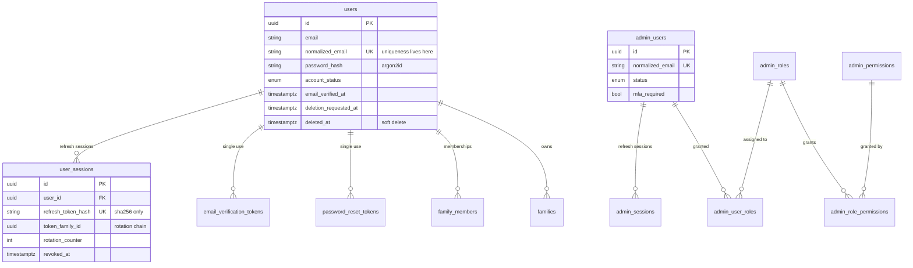
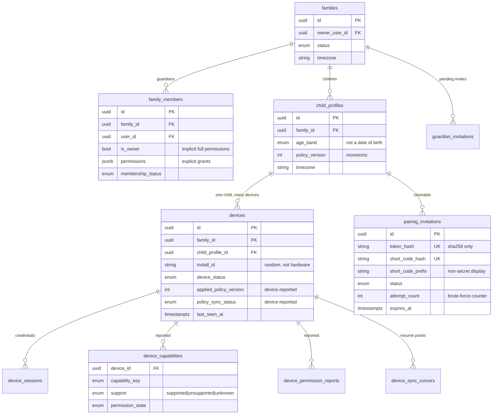
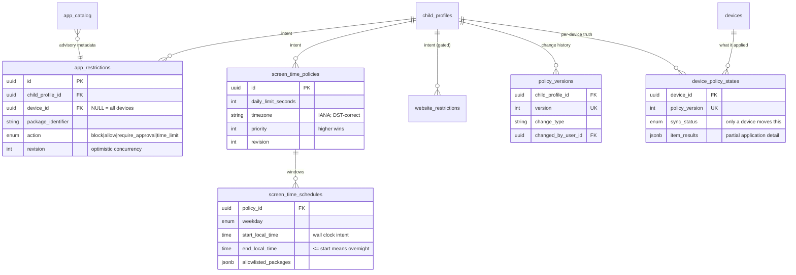
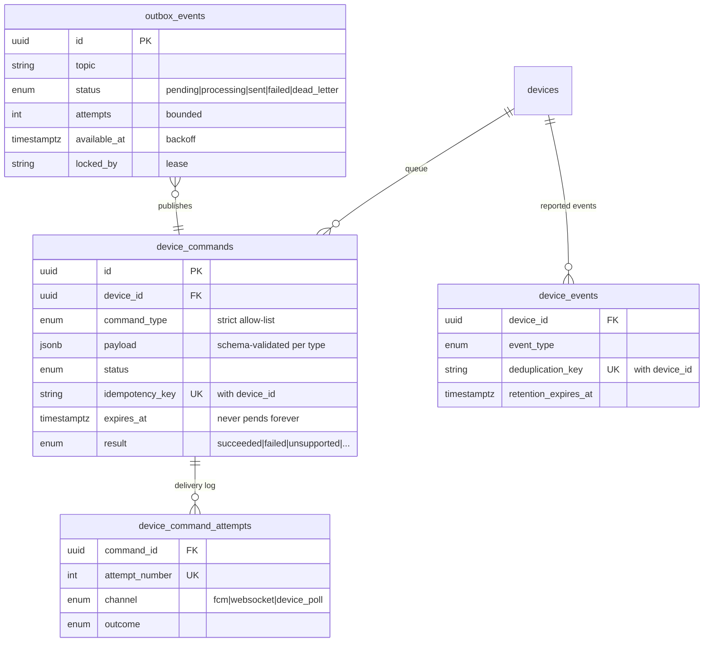
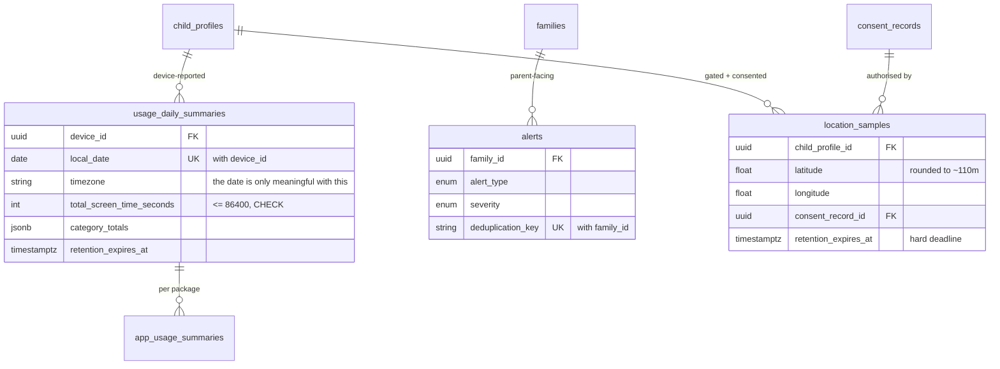
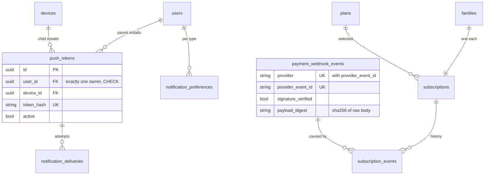
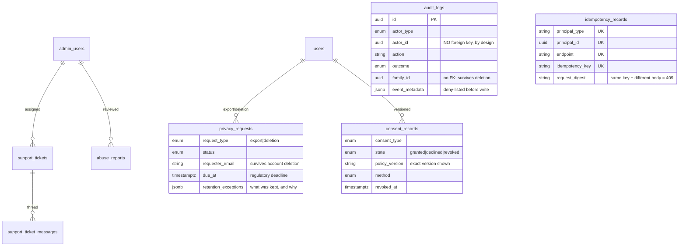

# Entity relationship diagram

50 tables in eight groups. `family_id` is the tenant key: it is carried
redundantly on child-scoped tables (devices, policies, commands, usage, alerts,
location) so an authorization predicate is a single column comparison rather
than a join chain.

## Identity and access

Parent and admin identities are separate tables with separate session tables
and separate token audiences, so a credential for one is never usable as the
other.

## Family, children, devices

`devices.install_id` is a random per-install identifier generated by the Child
App, not a hardware identifier. It exists so a factory reset re-pairs into the
same row instead of creating duplicates.

## Policies

Two numbers are deliberately kept apart: the version a command tried to deliver
and the version a device says it has applied. A failed move to v4 shows as "v4
unsupported" while the device is honestly still reported on v3.

## Commands and events

## Usage, alerts, location

## Notifications and billing

## Support, audit, privacy

`audit_logs` has **no foreign keys at all**. That is deliberate: deleting a
family must not be able to cascade away the record of what was done to it.
`tests/integration/test_migrations.py` asserts the table has no foreign keys.
